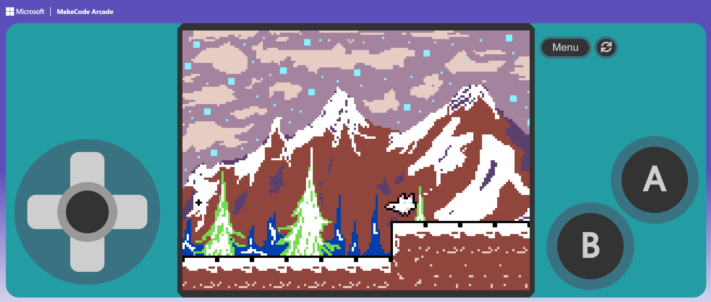

# Fox Runner

[](https://github.com/Dorayaki0122/fox-runner/actions)

Juego educativo de iniciación a la programación desarrollado en **Microsoft MakeCode Arcade** con **TypeScript** y programación por bloques, diseñado para alumnado de **4.º de ESO**.

> **[Abrir versión publicada en GitHub Pages](https://dorayaki0122.github.io/fox-runner/)**



---

## Objetivo didáctico

Fox Runner plantea el aprendizaje de la lógica de programación de forma visual y práctica. En lugar de controlar al personaje en tiempo real como en un plataformas convencional, el alumnado debe analizar cada pantalla y programar la secuencia de instrucciones que llevará al zorro hasta la meta.

A lo largo de **8 niveles de dificultad progresiva** se trabajan:

* **Secuenciación de instrucciones:** planificar el recorrido paso a paso antes de ejecutarlo.
* **Bucles contados (`repetir N veces`):** identificar patrones repetitivos para simplificar el código.
* **Bucles anidados:** combinar repeticiones dentro de repeticiones en recorridos más complejos (niveles 4, 6 y 8).
* **Descomposición modular:** estructurar la solución de cada pantalla en funciones independientes (`Nivel_1` a `Nivel_8`).
* **Depuración por ensayo y error:** ejecutar el algoritmo, detectar dónde falla o choca el personaje y corregir la lógica hasta superar el nivel.

---

## Cómo funciona

1. **Analiza el nivel:** observa las distancias, los cambios de dirección y los obstáculos del mapa.
2. **Programa el recorrido:** abre la función del nivel correspondiente (`Nivel_1`–`Nivel_8`) y encaja los bloques de movimiento dentro de estructuras `repetir`.
3. **Ejecuta y prueba:** pulsa el botón **A** en el simulador para lanzar el algoritmo y comprobar si el zorro llega a la meta.
4. **Ajusta la solución:** si el zorro se cae o se choca antes de tiempo, modifica el número de repeticiones o el orden de los saltos y vuelve a probar.

### Bloques personalizados disponibles

| Bloque | Acción |
| :--- | :--- |
| `moverse derecha` / `moverse izquierda` | Desplaza al zorro una posición en la dirección indicada. |
| `saltar derecha` / `saltar izquierda` | Ejecuta un salto simple con desplazamiento lateral. |
| `salto doble derecha` / `salto doble izquierda` | Ejecuta un salto doble para superar obstáculos más altos o largos. |

*(Nota de pruebas: la rama `Rama_Con_Soluciones` incluye un atajo en el botón **B** que llama a `Fijar_Nivel 8` para saltar directamente al último nivel).*

---

## Ramas del repositorio

* **`Rama_Con_Soluciones`:** versión completa del proyecto con las soluciones de los 8 niveles implementadas (`Nivel_1` a `Nivel_8`).
* **`Rama_Sin_Soluciones`:** plantilla limpia preparada para el alumnado, lista para importar en MakeCode Arcade y resolver los niveles desde cero.

---

## Abrir y editar en MakeCode Arcade

1. Entra en [arcade.makecode.com](https://arcade.makecode.com/).
2. Haz clic en **Importar** y selecciona **Importar URL**.
3. Pega el enlace de este repositorio y pulsa en **Importar**:

   ```text
   https://github.com/Dorayaki0122/fox-runner
   ```

---

## Colaboradores

Este juego fue realizado por estas 3 colaboradores para la asignatura "Lenguajes y Paradigmas de la Programación":

* Laura Álvarez Zamora ([@Dorayaki0122](https://github.com/Dorayaki0122))
* Pablo Fernández Herrera ([@alu0100817515](https://github.com/alu0100817515))
* Emilio González Díaz ([@alu0101316734](https://github.com/alu0101316734))
